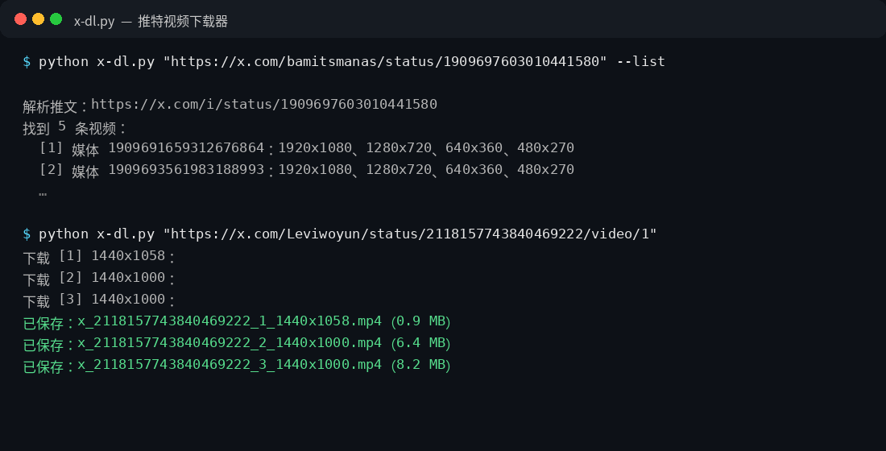
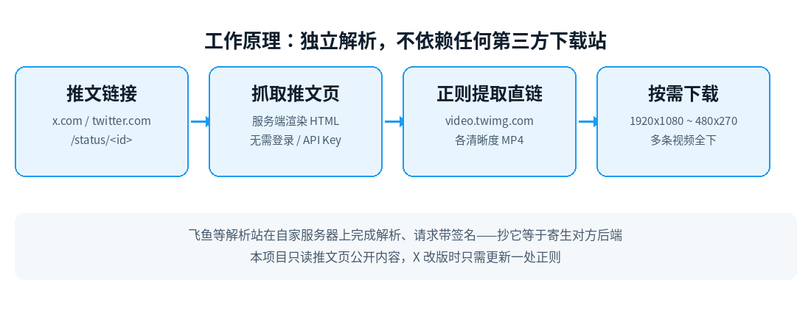

# 推特视频下载器 · X Downloader

<p>
  
</p>


粘贴推文链接，一键下载推文里的视频（多条视频全下，每条可选清晰度，最高 1080p）。零第三方依赖（纯 Python 标准库），不需要 API Key、不需要登录、不依赖任何第三方下载站。



## 功能亮点

- **独立解析**：直接抓推文页的服务端渲染 HTML，提取 `video.twimg.com` 各清晰度 MP4 直链——不走飞鱼等第三方后端，不怕对方改签名、关服务
- **多清晰度**：每条视频通常有 1920x1080 / 1280x720 / 640x360 / 480x270 四档，可指定 `--quality 1080` 或默认下最高清
- **多视频推文**：一条推文多条视频时全部下载，可用 `--index N` 只下其中一条
- **三种输入**：推文链接、推文 ID、`video.twimg.com` 直链都能直接下
- **三种形态**：命令行版、Web 版（给 Hark 这类只能开浏览器的 AI 用）、MCP 版（给 Claude Code / Codex 等支持 MCP 的 AI 用），共用同一套解析引擎

## 三种形态，任选其一

| 形态 | 目录 | 适合谁 |
|---|---|---|
| 命令行版 | 根目录 `x-dl.py` | 想要单文件、双击或终端批量跑的人 |
| Web 版 | [`web/`](web/) | 想部署到自己服务器、手机电脑都能开的人；也是给 Hark 用的入口 |
| MCP 版 | [`mcp/`](mcp/) | 想让其他 AI（Claude Code / Codex / Cursor 等支持 MCP 的客户端）直接调用的人：2 个工具 `x_parse / x_download`，配置见 [mcp/README.md](mcp/README.md) |

三者共用同一套解析引擎，X 改版时只需更新引擎文件。

## 快速开始

### 命令行版

```bash
# 下最高清（默认）
python x-dl.py "https://x.com/xxx/status/1909697603010441580"

# 只看有哪些清晰度，不下载
python x-dl.py "https://x.com/xxx/status/1909697603010441580" --list

# 指定清晰度（best / 1080 / 720 / 480 / 360 / lowest）
python x-dl.py "https://x.com/xxx/status/1909697603010441580" --quality 720

# 一条推文多条视频时，只下第 2 条
python x-dl.py "https://x.com/xxx/status/1909697603010441580" --index 2

# 直接下 video.twimg.com 直链
python x-dl.py "https://video.twimg.com/amplify_video/xxx/vid/avc1/1320x720/xxx.mp4?tag=29"

# 指定下载目录
python x-dl.py "https://x.com/xxx/status/1909697603010441580" --out D:\视频
```

Windows 也可双击 `双击运行.bat`。产物命名：`x_<推文ID>_<序号>_<宽>x<高>.mp4`，另附 `x_<推文ID>.json` 元数据。

### Web 版

```bash
cd web && python server.py        # 默认端口 8902，可用 PORT 环境变量改
```

浏览器打开即可用；可选访问口令（`X_DL_CODE` 环境变量，公网部署建议开启）。详见 [web/README.md](web/README.md)。

### MCP 版

```bash
# Claude Code
claude mcp add x-downloader -e X_DOWNLOAD_DIR="D:\x-downloads" -- python3 "D:\x-downloader\mcp\x_mcp_server.py"

# Codex
codex mcp add x-downloader -- python3 "D:\x-downloader\mcp\x_mcp_server.py"
```

加完后直接说"下载这条推文的视频：<链接>"即可。详见 [mcp/README.md](mcp/README.md)。

## 工作原理



1. 从推文链接提取推文 ID
2. 用浏览器 UA 请求推文页 `https://x.com/i/status/<id>`，拿到服务端渲染的 HTML
3. 正则提取其中全部 `video.twimg.com/.../vid/avc1/<宽>x<高>/<token>.mp4` 直链，按媒体分组、按清晰度排序
4. 按指定清晰度流式下载（失败自动重试 3 次），写元数据 JSON

> 为什么不逆向飞鱼（feiyudo.com）：它的解析在自家服务器上完成，前端请求带签名鉴权，外部直接调一律 401——抄它等于寄生它的后端，随时失效。本项目走独立路线，不依赖任何第三方解析服务。

## 目录结构

```
.
├── x-dl.py            # 命令行版（单文件，解析 + 下载引擎）
├── 双击运行.bat        # Windows 双击启动命令行版
├── mcp/               # MCP 版（stdio 服务器 + 配置示例）
├── web/               # Web 版（零依赖 HTTP 服务）
└── assets/            # README 配图（图标 / 命令行实测 / 原理图）
```

## 常见问题

- **解析失败？** 先确认推文是公开的；受保护、已删除、需登录的推文无法解析。同一 IP 高频请求也可能被限流，稍后重试。
- **直链能调画质吗？** 不能。`video.twimg.com` 直链本身是固定清晰度版本；想拿高清请用推文链接解析，工具会直接给到最高 1080p。
- **没有 1080p 档？** 取决于原推文上传的最高画质，工具会选现有档里最大的一档。
- **X 改版失效了怎么办？** 解析逻辑集中在引擎的 `fetch_tweet_videos` 一处，按新的推文页结构调整正则即可，界面层不用动。

## 实测记录

| 测试 | 结果 |
|---|---|
| 推文 `bamitsmanas/status/1909697603010441580`（5 条视频） | 解析成功，每条 4 档（1920x1080 起） |
| `--quality 720 --index 1` | 下载成功，1280x720、56.2 秒、3.1 MB |
| `--quality best --index 2` | 下载成功，1920x1080、4.6 MB |
| video.twimg.com 直链输入 | 下载成功 |
| 不存在的推文 ID | 干净报错：HTTP 404 |
| MCP `x_parse` / `x_download` | 握手、解析、下载均通过 |

## 免责声明

本项目仅供学习研究与个人素材管理使用。下载的视频版权归原作者所有，请勿搬运、冒充原创或用于商业侵权用途；使用者自行承担相应责任。

## License

[MIT](LICENSE)
